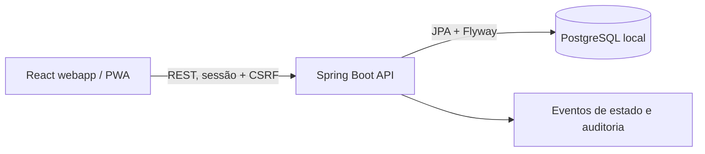

# VitaLink

**AMBIENTE DE SIMULAÇÃO.** Este projeto registra ocorrências fictícias e não aciona o SAMU, ambulâncias ou hospitais reais. Em uma emergência real, ligue **192**.

VitaLink é um protótipo web mobile-first para demonstrar um fluxo entre paciente, central fictícia e hospital fictício. Ele usa apenas dados sintéticos e não se destina a uso clínico ou emergencial.

## Requisitos

- Docker Engine e Docker Compose
- Node.js 22+ e npm, caso execute o frontend fora do Compose
- Java 21, caso execute o backend fora do Compose (o repositório não requer Maven instalado para o caminho Compose)

## Executar localmente

```sh
cp .env.example .env
docker compose up --build
```

Abra <http://localhost:5173>. A API local responde em <http://localhost:8080>. O PostgreSQL é publicado somente em `127.0.0.1`. As credenciais padrão do Compose são exclusivamente locais e sintéticas; não reutilize esses valores fora do computador de desenvolvimento.

Para recuperar uma senha no ambiente local, use **Esqueci minha senha** na tela de login e consulte a caixa de entrada fictícia do Mailpit em <http://localhost:8025>. O link expira em 30 minutos e não é exibido pela API.

Para encerrar, use `Ctrl+C` e `docker compose down`. Para apagar também o banco sintético, use `docker compose down -v`.

## Demonstração

O seed local cria contas sintéticas com a mesma senha `Demo1234!`. Também é possível cadastrar uma conta de paciente adulto pela tela inicial; cadastro não exige confirmação por email. Emails de recuperação de senha são enviados apenas à caixa fictícia local do Mailpit:

| Perfil | E-mail |
|---|---|
| Paciente | `patient@vitalink.local` |
| Central fictícia | `dispatcher@vitalink.local` |
| Hospital fictício | `hospital@vitalink.local` |
| Administrador técnico | `admin@vitalink.local` |

O ID de hospital para vinculação pela central é `10000000-0000-4000-8000-000000000002`. Não insira dados pessoais ou médicos reais.

O painel do hospital inicia com três ocorrências de exemplo, cada uma com perfil clínico sintético e estado diferente. O seed é idempotente e serve apenas para demonstração local.

O perfil **Administrador técnico** (`admin@vitalink.local`) abre um painel restrito com contagens agregadas de contas, instituições, ocorrências e solicitações de exclusão pendentes. O painel não exibe dados pessoais ou clínicos.

Na área do paciente há um painel de **ligações simuladas** para experimentar chamadas fictícias da central e do hospital. Atender, recusar e encerrar só atualiza o histórico temporário da tela; não usa telefonia nem faz contato real.

## Limites e segurança

- Não há integração com serviços públicos, telefonia, despacho ou instituições reais.
- Nenhuma configuração pode transformar este protótipo em serviço de emergência real.
- Não use o ambiente local para dados pessoais ou clínicos reais.
- A interface deve manter a opção **Ligar 192** disponível e nunca alegar que uma ligação ou atendimento foi realizado.
- Antes de qualquer uso fora de demonstração seriam necessários, entre outros requisitos, parceria e autorização institucional, revisão jurídica/LGPD e clínica, avaliação independente de segurança, MFA e operação 24/7. Este repositório não comprova esses requisitos.

## Stack prevista

- Web: React, TypeScript, Vite e PWA
- API: Java 21, Spring Boot, REST e Flyway
- Persistência: PostgreSQL

No backend, o código fica agrupado por domínio em `br.com.vitalink.modules` (`auth`, `patients`, `emergencies`, `institutions`, `audit`). Controllers tratam HTTP, services guardam os casos de uso e repositories acessam a persistência. DTOs, erros e filtros compartilhados ficam em `br.com.vitalink.shared`.



## Documentação

Os requisitos completos estão em [`docs/`](docs/), com prioridade para `00-LEIA-PRIMEIRO.md` e os critérios em `11-CRITERIOS-DE-ACEITE.md`. O roteiro incremental está em `10-PLANO-DE-IMPLEMENTACAO.md`.

## Estado da implementação

Cadastro/login e recuperação de senha, perfil básico, até três contatos de emergência, exportação JSON do titular, solicitação auditada de exclusão, perfil médico autodeclarado, pedidos simulados idempotentes, localização manual ou do navegador, polling, transições, atribuição hospitalar com grant, resumo autorizado, auditoria, timeline, cancelamento solicitado e PWA estão implementados. A exclusão fica pendente de análise e retenção, não é executada automaticamente. O CI em `.github/workflows/ci.yml` executa testes e build, `npm audit`, OWASP Dependency-Check (CVSS >= 7) e Gitleaks.

Ainda pendem processamento administrativo de solicitações de exclusão, concorrência/IDOR com testes de integração, testes E2E e revisão manual de acessibilidade e segurança. A recuperação local usa Mailpit e não configura envio de email real. Não trate este protótipo como serviço de emergência real.
