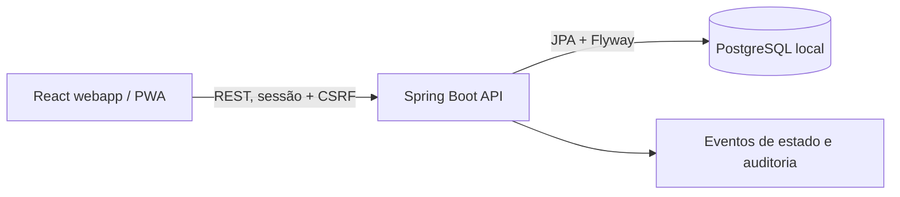

# VitaLink

**AMBIENTE DE SIMULAÇÃO.** Este projeto registra ocorrências fictícias e não aciona o SAMU, ambulâncias ou hospitais reais. Em uma emergência real, ligue **192**.

VitaLink é um protótipo web mobile-first para demonstrar um fluxo entre paciente, central fictícia e hospital fictício. Ele usa apenas dados sintéticos e não se destina a uso clínico ou emergencial.

## Requisitos

- Docker Engine e Docker Compose
- Node.js 22+ e npm, caso execute o frontend fora do Compose
- Java 21, caso execute o backend fora do Compose (o repositório não requer Maven instalado para o caminho Compose)

## Executar localmente

```sh
cp .env.example .env
docker compose up --build
```

Abra <http://localhost:5173>. A API local responde em <http://localhost:8080>. O PostgreSQL é publicado somente em `127.0.0.1`. As credenciais padrão do Compose são exclusivamente locais e sintéticas; não reutilize esses valores fora do computador de desenvolvimento.

Para encerrar, use `Ctrl+C` e `docker compose down`. Para apagar também o banco sintético, use `docker compose down -v`.

## Demonstração

O seed local cria contas sintéticas com a mesma senha `Demo1234!`. Também é possível cadastrar uma conta de paciente adulto pela tela inicial; o ambiente local não envia e-mails:

| Perfil | E-mail |
|---|---|
| Paciente | `patient@vitalink.local` |
| Central fictícia | `dispatcher@vitalink.local` |
| Hospital fictício | `hospital@vitalink.local` |
| Administrador técnico | `admin@vitalink.local` |

O ID de hospital para vinculação pela central é `10000000-0000-4000-8000-000000000002`. Não insira dados pessoais ou médicos reais.

## Limites e segurança

- Não há integração com serviços públicos, telefonia, despacho ou instituições reais.
- Nenhuma configuração pode transformar este protótipo em serviço de emergência real.
- Não use o ambiente local para dados pessoais ou clínicos reais.
- A interface deve manter a opção **Ligar 192** disponível e nunca alegar que uma ligação ou atendimento foi realizado.
- Antes de qualquer uso fora de demonstração seriam necessários, entre outros requisitos, parceria e autorização institucional, revisão jurídica/LGPD e clínica, avaliação independente de segurança, MFA e operação 24/7. Este repositório não comprova esses requisitos.

## Stack prevista

- Web: React, TypeScript, Vite e PWA
- API: Java 21, Spring Boot, REST e Flyway
- Persistência: PostgreSQL

No backend, o código fica agrupado por domínio em `br.com.vitalink.modules` (`auth`, `patients`, `emergencies`, `institutions`, `audit`). Controllers tratam HTTP, services guardam os casos de uso e repositories acessam a persistência. DTOs, erros e filtros compartilhados ficam em `br.com.vitalink.shared`.



## Documentação

Os requisitos completos estão em [`docs/`](docs/), com prioridade para `00-LEIA-PRIMEIRO.md` e os critérios em `11-CRITERIOS-DE-ACEITE.md`. O roteiro incremental está em `10-PLANO-DE-IMPLEMENTACAO.md`.

## Estado da implementação

O scaffold, cadastro/login de paciente, perfil médico, pedidos simulados idempotentes, transições, atribuição hospitalar com grant, resumo autorizado, auditoria e timeline estão implementados no código. Ainda faltam recuperação de senha, perfil básico/contatos, solicitações de exportação/exclusão, testes de integração e E2E, e revisão manual de acessibilidade e segurança. O build e os testes ainda não foram verificados neste ambiente.
